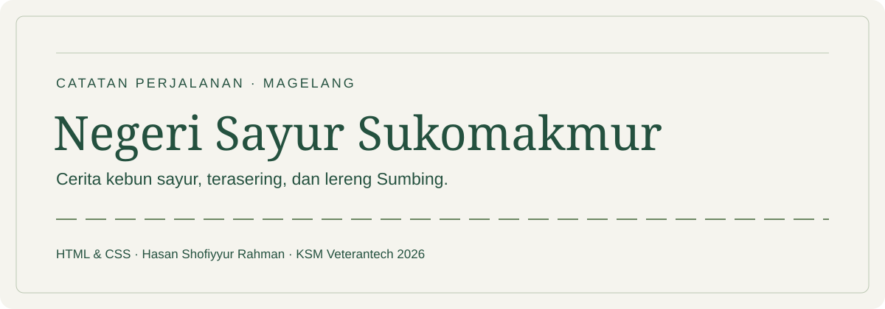
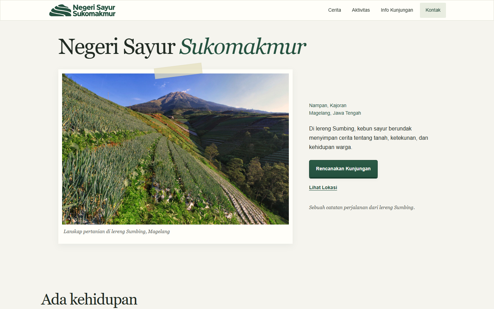

[](LICENSE)

# Negeri Sayur Sukomakmur

Website satu halaman berbahasa Indonesia tentang Negeri Sayur Sukomakmur di Dusun Nampan, Desa Sukomakmur, Kecamatan Kajoran, Kabupaten Magelang. Konsepnya adalah catatan perjalanan: warna kertas hangat, hijau hutan, foto berbingkai, dan formulir seperti kartu pos.

Proyek individu **Study Club Frontend Basic KSM Veterantech UPNVJ 2026**, dibuat oleh **Hasan Shofiyyur Rahman**. Website ini merupakan proyek belajar, bukan situs resmi pengelola wisata. Ketentuan tugas tersedia di [instruksi mini project](instruksi_mini_project_frontend.md), acuan materi di [SCFE Basic P1–P4](scfe_basic_p1_p4.md), dan brief lengkap di [prompt proyek](Prompt_Codex_Web_Negeri_Sayur_Sukomakmur.md).

**Status aset:** dua varian logo asli pengguna dan enam foto sudah dipasang. Foto utama serta foto berkabut memberi konteks kawasan Sumbing/Magelang; foto jalur pengunjung terverifikasi sebagai Negeri Sayur Sukomakmur. Kredit dan lisensi tersedia di footer serta [panduan aset](docs/ASSETS.md).

## Preview dan cara membuka

Buka `index.html` langsung di browser, atau gunakan **Open with Live Server** pada file tersebut di VS Code. Seluruh konten, stylesheet, logo, dan foto menggunakan file lokal. Website dapat tampil tanpa internet; tautan ke Maps, media sosial, dan referensi memerlukan koneksi saat dibuka.

Alternatif jika Python sudah tersedia, jalankan dari root proyek:

```powershell
python -m http.server 8000 --bind 127.0.0.1
```

Lalu buka [preview lokal](http://127.0.0.1:8000/). Server ini hanya alat preview; tidak ada backend aplikasi. Hentikan dengan `Ctrl+C` ketika selesai. Tidak diperlukan `npm install`, build step, maupun instalasi skill untuk membuka website.



Screenshot diambil dari implementasi di Chrome pada 18 Oktober 2026. Lihat juga [halaman penuh desktop](docs/media/preview-desktop.png), [halaman penuh ponsel](docs/media/preview-mobile.png), dan [menu ponsel terbuka](docs/media/preview-mobile-menu.png). [Pembuka sebelum penyempurnaan proporsi](docs/media/preview-before-proportion.png) disimpan untuk perbandingan. Header SVG di awal README merupakan ilustrasi dokumentasi beranimasi, bukan screenshot atau foto destinasi.

Revisi 18 Oktober 2026 diperiksa di Chrome melalui `file://` dengan JavaScript dinonaktifkan: sumber **35/35**, HTML ekspor **37/37**, navbar **84/84**, dan pemeriksaan tambahan proporsi/menu **66/66** lolos. Lebar yang diperiksa mencakup **1440, 1366, 768, 390, dan 320 px**; cakupan tiap pemeriksaan dijelaskan di [catatan belajar](docs/LEARNING-NOTES.md#pemeriksaan-dan-status-skill). Safari/Firefox, perangkat fisik, pembaca layar, dan zoom browser 200% belum diuji.

## Fitur dan stack

| Bagian | Yang dipelajari dan diterapkan |
| --- | --- |
| Header dan hero | Header ringkas dengan menu desktop dan menu buka/tutup khusus ponsel; navbar sticky dengan animasi scroll CSS opsional. Judul dibatasi 64 px, foto lanskap tampil utuh, dan catatan beserta CTA sejajar di tengah foto pada desktop. |
| Cerita | Dua paragraf yang disusun bersama foto lokasi utama berukuran lebih besar dan foto konteks kawasan yang lebih kecil, lengkap dengan caption serta sumber. |
| Aktivitas dan persiapan | `ul` untuk aktivitas dan `ol` untuk langkah persiapan kunjungan. |
| Informasi kunjungan | Pita alamat ringkas di atas tabel fasilitas selebar konten, dengan `caption`, header kolom/baris, serta sumber historis. |
| Kontak | Label yang terlihat, input nama/email, textarea, dan validasi bawaan browser. |
| Rekomendasi | Tiga bingkai foto besar berjajar untuk Nepal van Java, Ketep Pass, serta Punthuk Setumbu; menjadi satu kolom pada ponsel. |
| Footer | Identitas pembuat, portofolio, Instagram, email, dan kredit foto yang dapat dibuka/tutup. |
| Kenyamanan | Layout responsif, focus keyboard, skip link, reduced motion, serta scroll tabel yang dibatasi pada pembungkusnya. |

Website memakai **HTML5 dan satu file CSS native**, tanpa JavaScript, framework, dependency runtime, database, atau build system. Judul memakai Georgia dan teks isi memakai Arial dengan fallback sistem; tidak ada font eksternal yang wajib dimuat. Skill serta alat pemeriksaan adalah bagian proses pengembangan, bukan bagian yang dijalankan browser pengunjung.

HTML menyimpan isi dan urutan baca. Flexbox menyusun navbar, tombol, alamat, dan kelompok tautan. Grid menempatkan judul hero melintasi dua kolom, lalu foto di kiri dan catatan sejajar tengah di kanan. Lebar hero dibatasi 1100 px agar pembuka lebih proporsional. Pada layar sempit, urutannya menjadi judul, foto, lalu catatan beserta tombol, sesuai urutan HTML. Cerita memakai foto yang berbeda ukuran; tabel mendapat lebar penuh; rekomendasi menjadi tiga bingkai sejajar di desktop/tablet dan satu kolom pada lebar maksimal 650 px. Penjelasan yang dapat dipakai saat presentasi ada di [catatan belajar](docs/LEARNING-NOTES.md).

CSS tambahan meliputi `grid-template-areas`, `minmax()`, `clamp()`, `box-shadow` untuk bingkai foto/tombol dan inset field, gradient tipis pada tombol, `border-radius`, `object-fit`, `transition`, media query, serta pseudo-element selotip. Foto tetap tegak; rotasi kecil hanya dipakai pada selotip. Semua dipakai untuk kesan jurnal yang ringan; perinciannya dijelaskan di catatan belajar.

Evaluasi tata letak dan hasil penyempurnaannya dicatat di [ulasan desain](docs/DESIGN-REVIEW.md). Warna kertas, hijau, Georgia/Arial, dua logo asli, serta bingkai foto tetap mengikuti preferensi pengguna.

Navbar dimulai sebagai bilah yang menempel di atas, lalu mengambang setelah 160 px scroll menggunakan `animation-timeline` dan `animation-range`. `@supports` menjaga browser yang belum mendukung tetap memakai navbar sticky. Mode reduced motion juga memakai versi tanpa animasi. Pada lebar maksimal 650 px, menu desktop diganti `details`/`summary` native dengan tombol **Menu/Tutup** dan empat tautan dalam dua kolom. Menu tetap terbuka setelah memilih tujuan; gunakan **Tutup** untuk menutupnya. Penanda tautan mengikuti tujuan anchor, bukan posisi scroll secara langsung. Penjelasan bertahap tersedia di [cara kerja navbar](docs/LEARNING-NOTES.md#cara-kerja-navbar-tanpa-javascript).

Instruksi tugas tidak secara khusus mewajibkan tampilan mobile atau JavaScript. Proyek tetap dibuat responsif untuk desktop dan ponsel. Navigasi anchor, menu ponsel, validasi form, dan buka/tutup kredit adalah interaksi bawaan HTML.

## Struktur proyek

```text
negeri_sayur_sukomakmur/
├── index.html                         # Sumber halaman utama
├── assets/
│   ├── css/style.css                  # Seluruh gaya website
│   └── images/
│       ├── brand/                     # Dua logo SVG asli
│       ├── destination/               # Foto Sukomakmur dan konteks kawasan sekitar
│       └── recommendations/           # Tiga foto rekomendasi
├── docs/
│   ├── ASSETS.md                      # Pemetaan aset dan cara mengganti foto
│   ├── LEARNING-NOTES.md              # Penjelasan kode dan hasil pemeriksaan
│   ├── DESIGN-REVIEW.md               # Evaluasi dan penyempurnaan tata letak
│   └── media/                        # Header SVG dan screenshot nyata
├── .agents/skills/                    # Skill desain lokal dari installer
├── AGENTS.md                          # Preferensi proyek dan panduan penggunaan skill
├── skills-lock.json                   # Catatan pemasangan skill
├── logo-horizontal.svg                # Logo asli yang diberikan pengguna
├── logo-simbol.svg                    # Simbol asli yang diberikan pengguna
├── README.md
├── LICENSE
├── .gitignore
└── submission/                        # Hasil ekspor, diabaikan Git
```

Tiga dokumen brief/materi di root tetap dipertahankan. `index.html` dan `assets/css/style.css` adalah sumber yang diedit; `submission/` selalu disalin ulang dari keduanya.

## Mencoba formulir

Form menggunakan `method="get"` dan `action="#kontak"`. Coba dengan isian kosong untuk melihat kewajiban mengisi, lalu email yang tidak valid, kemudian data contoh yang valid seperti `Teman Perjalanan`, `contoh@example.com`, dan `Ini pesan latihan.`

Setelah input valid, browser membuka kembali halaman pada bagian kontak dengan `nama`, `email`, dan `pesan` sebagai parameter URL. **Tidak ada pesan yang dikirim, data yang disimpan aplikasi, atau reservasi yang dibuat.** Gunakan data contoh. Tautan **Kirim email** terpisah membuka aplikasi email menuju pembuat website.

## Menyiapkan paket pengumpulan

Nama berkas mengikuti ketentuan tugas:

```text
submission/
├── Source Code_Hasan Shofiyyur Rahman.html
├── Source Code_Hasan Shofiyyur Rahman.css
└── assets/images/
    ├── brand/
    ├── destination/
    └── recommendations/
```

Jalankan perintah PowerShell berikut dari root proyek **setelah sumber selesai diperbarui**. Resep menyalin isi setiap folder gambar ke tujuan yang sama sehingga dapat dijalankan ulang tanpa membentuk folder `images/images`.

```powershell
New-Item -ItemType Directory -Force -Path 'submission/assets/images' | Out-Null

$htmlSource = Get-Content -Raw -Encoding UTF8 -LiteralPath 'index.html'
$htmlExport = $htmlSource.Replace(
  'href="assets/css/style.css"',
  'href="Source Code_Hasan Shofiyyur Rahman.css"'
)
Set-Content -Encoding UTF8 -LiteralPath 'submission/Source Code_Hasan Shofiyyur Rahman.html' -Value $htmlExport
Copy-Item -LiteralPath 'assets/css/style.css' -Destination 'submission/Source Code_Hasan Shofiyyur Rahman.css' -Force

foreach ($imageFolder in @('brand', 'destination', 'recommendations')) {
  $sourceFolder = Join-Path 'assets/images' $imageFolder
  $targetFolder = Join-Path 'submission/assets/images' $imageFolder
  New-Item -ItemType Directory -Force -Path $targetFolder | Out-Null
  Get-ChildItem -LiteralPath $sourceFolder -File | Copy-Item -Destination $targetFolder -Force
}
```

Buka HTML di `submission/` dan periksa kembali gambar, stylesheet, tautan internal, serta form. Jika sebelumnya ada foto yang diganti nama atau dihapus dari sumber, hapus juga salinan lama yang sudah tidak digunakan dari folder ekspor. Kumpulkan HTML, CSS, dan folder gambar bersama agar path relatif tetap berfungsi. Jangan mengedit sumber dan hasil ekspor sebagai dua versi terpisah.

Paket berisi HTML, CSS, dan seluruh gambar lokal. Tenggat pada instruksi tugas adalah **Jumat, 23 Oktober 2026 pukul 23.59 WIB**, melalui kelas peminatan Frontend pada Dignition Veterantech.

## Repository GitHub

Repository proyek: [yurnszzz/negeri-sayur-sukomakmur](https://github.com/yurnszzz/negeri-sayur-sukomakmur), dengan branch utama `main` dan remote `origin` menuju repository tersebut.

`.gitignore` mengabaikan `submission/`, dependency alat, cache, log, serta berkas sementara. Source utama, gambar, dokumentasi, dan skill lokal ikut dilacak. Paket pengumpulan dibuat ulang dari source sesuai petunjuk di atas.

Untuk mengirim perubahan berikutnya, jalankan dari root proyek:

```powershell
git status
git add .
git diff --cached --stat
git commit -m "Jelaskan perubahan yang dibuat"
git push
```

Tinjau perubahan sebelum commit. GitHub Pages dan workflow deployment belum dikonfigurasi; website dapat diperiksa dengan membuka `index.html` atau memakai Live Server.

## Referensi dan status informasi

Informasi fasilitas tidak dimaksudkan sebagai jaminan kondisi terkini. Tarif, jam buka, nomor pengelola, dan angka jarak/ketinggian tidak dicantumkan tanpa verifikasi. Pengunjung diarahkan untuk mengonfirmasi kondisi sebelum berangkat.

- [Profil Desa Sukomakmur oleh tim KKN](https://desa-sukomakmur.vercel.app/): konteks desa; bukan diklaim sebagai portal resmi pemerintah.
- [PPID Kabupaten Magelang: pertanian loncang Sukomakmur](https://ppid.magelangkab.go.id/berita/harga-loncang-stabil-petani-sukomakmur-tetap-untung-di-musim-kemarau): konteks kehidupan pertanian.
- [Koran Jakarta, 4 Januari 2025](https://koran-jakarta.com/2025-01-04/keelokan-terasering-pertanian-sayur-desa-sukomakmur-di-punggung-sumbing-yang-menyejukkan-hati/amp): referensi fasilitas; kondisi saat ini tetap perlu dikonfirmasi.
- [Nepal van Java](https://visitjawatengah.jatengprov.go.id/id/artikel/menyusuri-pesona-nepal-van-java-surga-tersembunyi-di-magelang), [Ketep Pass](https://visitjawatengah.jatengprov.go.id/id/destinasi-wisata/ketep-pass), dan [Punthuk Setumbu](https://visitjawatengah.jatengprov.go.id/id/destinasi-wisata/punthuk-setumbu): halaman informasi Dinas Pariwisata Provinsi Jawa Tengah.
- [Repository contoh heart-disease-prediction](https://github.com/yurnszzz/heart-disease-prediction): acuan yang diminta dalam brief. README dan LICENSE repository ini belum berhasil dibaca: akses halaman GitHub/raw tidak mengembalikan konten, dan percobaan jaringan lanjutan terhenti tanpa hasil. Susunan dokumentasi mengikuti pola yang dijelaskan dalam brief; lisensi proyek memakai teks MIT standar. Tidak ada aset yang diambil atau perubahan pada repository contoh.

Hasil pemeriksaan aktual dan status penggunaan skill dicatat di [LEARNING-NOTES](docs/LEARNING-NOTES.md#pemeriksaan-dan-status-skill). Sumber, lisensi, dan panduan penggantian foto ada di [ASSETS](docs/ASSETS.md).

Taste Skill dan UI UX Pro Max tetap tersedia. Impeccable serta Emil Design Engineering sudah ditambahkan secara lokal untuk evaluasi UI dan gerak. [AGENTS.md](AGENTS.md) menyimpan arahan penggunaan keempatnya untuk pengerjaan berikutnya; semuanya merupakan alat bantu pengembangan, bukan dependency website.

## Pembuat dan lisensi

**Hasan Shofiyyur Rahman** — [Portofolio](https://portofolio-hasan-shofiyyur-rahman.vercel.app/) · [Instagram](https://www.instagram.com/yurnsz/) · [Email](mailto:hasanshofiyyur@gmail.com).

Source code dan dokumentasi buatan proyek menggunakan [MIT License](LICENSE), © 2026 Hasan Shofiyyur Rahman. Logo, foto, aset pihak ketiga, dan skill mengikuti hak atau lisensi masing-masing; keberadaannya di repository tidak otomatis mengubah lisensinya menjadi MIT. Lisensi upstream skill dan ketentuan foto tersedia di [THIRD-PARTY-LICENSES](docs/THIRD-PARTY-LICENSES.md).
